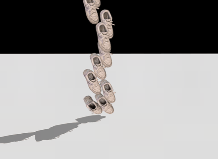

# Gaussian Splatting

A real-time [3D Gaussian Splatting](https://repo-sam.inria.fr/fungraph/3d-gaussian-splatting/) renderer written from scratch in C++ and OpenGL 4.3.

<p align="center">
  
  <br>
  <a href="https://drive.google.com/file/d/1Lg1oc6Tm3o30cZ6-ltT4_NxKR8qD--nG/view">Full demo video</a>
</p>

## How it works

Each Gaussian is drawn as one quad (with instancing), and the [vertex shader](shaders/instancing/instancing.vert.glsl) does the math.

**Projection.** We move the 3D covariance $\Sigma$ to camera space with the view matrix $V$, then project it in 2D. The perspective projection is not linear, so we linearize it around the center $(x, y, z)$ of the Gaussian with its Jacobian:

```math
J = \begin{pmatrix} -f_x/z & 0 & f_x x/z^2 \\ 0 & -f_y/z & f_y y/z^2 \end{pmatrix}, \qquad \Sigma' = J V \Sigma V^\top J^\top
```

$\Sigma'$ is a $2 \times 2$ covariance, so on screen the Gaussian is an ellipse.

**Quad.** We align the quad with the eigenvectors of $\Sigma'$, computed in closed form:

```math
\Sigma' = \begin{pmatrix} a & c \\ c & b \end{pmatrix}, \qquad \lambda_{1,2} = \frac{(a+b) \pm \sqrt{(a+b)^2 - 4(ab - c^2)}}{2}, \qquad e_1 \propto (\lambda_1 - b, c), \qquad e_2 \perp e_1
```

It only covers a spread $s$ along those axes, up to where the opacity $\alpha$ drops below a cutoff:

```math
\alpha e^{-s^2/2} = \alpha_{\text{cut}} \quad \Rightarrow \quad s = \sqrt{2 \ln(\alpha / \alpha_{\text{cut}})}
```

So a corner $`(u, v) \in \{-1, 1\}^2`$ of the quad lands at $`\text{center} + s (u \sqrt{\lambda_1} e_1 + v \sqrt{\lambda_2} e_2)`$.

**Color.** The [fragment shader](shaders/instancing/instancing.frag.glsl) gives each pixel the color of the Gaussian, with an opacity that decays like the Gaussian, and the quads are blended back to front:

```glsl
float alpha = min(1.0, frag_opacity * exp(-0.5 * dot(uv, uv)));
if (alpha < alpha_cutoff) discard;
FragColor = vec4(frag_color, alpha);
```

## Physics experiments

On the [`stable-physics`](../../tree/stable-physics) branch, the splats become rigid bodies that you can drop, pile up and grab, simulated with the [Bullet](https://github.com/bulletphysics/bullet3) physics library.

<p align="center">
  
</p>

**Collisions.** A splat has no surface, so there is nothing to collide with. We extract a mesh of the same object with MILo [1] (we ran [MILo's code](https://github.com/Anttwo/MILo)) and give its convex hull to Bullet as the collision shape.

**Moving the splats.** Each frame, Bullet gives a rotation $R$ and a translation $T$ per object, and we apply them to every Gaussian of the object:

```math
\mu \mapsto R\mu + T, \qquad \Sigma \mapsto R \Sigma R^\top
```

The rest of the renderer is unchanged: it just sees new centers and covariances.

**Shadows.** The same mesh is flattened on the ground along the light direction with a planar projection matrix.

**Interaction.** The camera is first person and collides with the objects. A left click casts a ray, and the object it hits follows the camera until you release it.

## Run

Needs OpenGL 4.3+ (no macOS) and a 3DGS `.ply` at `assets/nike/scene.ply`.

```bash
cmake --preset relwithdebinfo && cmake --build --preset relwithdebinfo && ./project
```

## Credits

Made with [Octave Gaspard](https://github.com/octavegg), on the [CGP](https://github.com/drohmer/cgp) library of our professor Damien Rohmer. Scenes from [SuperSplat](https://superspl.at).

[1] A. Guédon, D. Gomez, N. Maruani, B. Gong, G. Drettakis, M. Ovsjanikov. [*MILo: Mesh-In-the-Loop Gaussian Splatting for Detailed and Efficient Surface Reconstruction*](https://arxiv.org/abs/2506.24096). SIGGRAPH Asia 2025 (TOG).
